<p align="center">
  <picture>
    <source media="(prefers-color-scheme: dark)" srcset="docs/logo/skiff-logo.svg">
    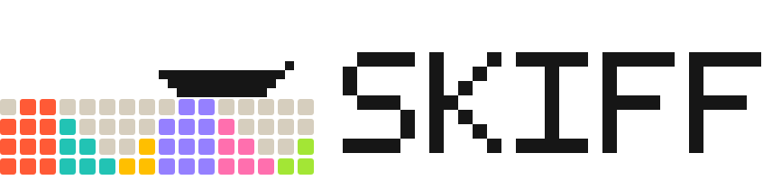
  </picture>
</p>

<p align="center"><b>A six-track groovebox firmware for the M-VAVE FM-1</b><br>
synths and drums, patterns and songs, live performance, and a screen that shows what every control does</p>

<p align="center">
  <a href="https://github.com/illuminus5/skiff/releases/latest"></a>
  <a href="LICENSE"></a>
  
</p>

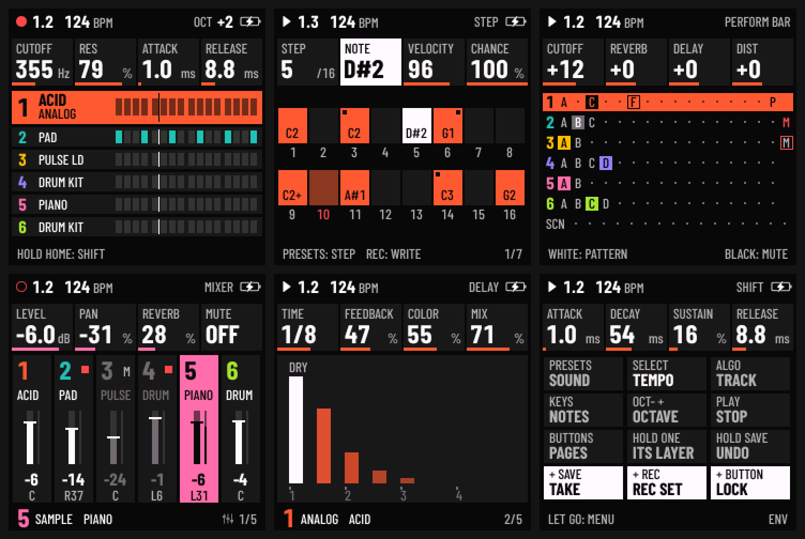

Skiff turns the FM-1 into a six-track groovebox: fourteen synth and drum engines, a 64-step sequencer with chords,
ratchets, trig conditions and parameter locks, a shared pool of patterns played through per-track lists and scenes,
and a performance layer for launching it all live. Every page draws what its knobs do, and holding HOME shows what
every button, encoder and key does right there. FM6 sounds can be built from a bare sine on the unit itself, every
operator's envelope drawn as it plays and coloured by how bright the FM makes it. A browser editor reaches all of it
from a computer.

Skiff is free software, a fork of [Felucca](https://github.com/hugelton/Felucca) 1.1.5 by Hügelton Instruments: it
keeps Felucca's engines, sound and file formats, so Felucca's sounds and projects load in Skiff. Skiff is not
Felucca: please report Skiff's behaviour [here](https://github.com/illuminus5/skiff/issues), not in Felucca's Issues.

## Install

Custom firmware, at your own risk; the way back to the official firmware is below.

**In the browser** (Chrome or Edge on a computer): open the [Skiff installer](https://illuminus5.github.io/skiff/webapp/installer/),
connect the FM-1 by USB and follow it. The same page takes the FM-1 back to the official V15 firmware, saving a
complete backup of your music first.

**With Python 3:** download `skiff-1.1.fwsc` from the [latest release](https://github.com/illuminus5/skiff/releases/latest)
and, with this repository's `tools/` folder,

```
pip install mido python-rtmidi
python tools/fm1_install.py skiff-1.1.fwsc
```

It takes about two minutes and the FM-1 restarts on Skiff.

**Back to the official firmware:** the installer page above, `python tools/fm1_install.py FM-1.fwsc` with M-VAVE's
file, or M-VAVE's own updater. **Edit from a computer:** the [Skiff Editor](https://illuminus5.github.io/skiff/webapp/editor/) (Chrome or
Edge, over USB MIDI).

## At a glance

| | |
| --- | --- |
| **Tracks** | 6, each with its own engine, sound, sequence and mix; 8 voices shared between them (T5 and T6 play every engine but PHYS and GRAIN) |
| **Engines** | 14: ANALOG, FM6, PHASE, LOFI, SAMPLE, VOICE, TRIO, WHEEL, GRAIN, PHYS, NOISE, SLICE, DRUM, DRUM-X; 100 factory sounds; every value of an FM6 patch (6 operators, 32 algorithms) editable on the unit |
| **Sequencer** | 64 steps a track; LENGTH 1–64; 1/1 to 1/32, triplets, 2 and 4 bars a step; chords of up to 4 notes, velocity, accent, slide, tie; per-step chance, ratchet ×1–4 or FLAM, 12 trig conditions (FILL, !FILL, 1:2 … 4:4), NUDGE (−32 to +31 64ths of a step); swing, gate; FWD, RVRS, PING or RAND |
| **Recording** | live with overdub, FEEL (keeps where you played), count-in and click; step recording; TAKE keeps the last loop you played, after the fact |
| **Automation** | knob moves and parameter locks (hold a step, turn a knob), 64 records, listed and edited on SEQ › AUTOMATION |
| **Patterns and songs** | a pool of 64 patterns shared by every project; each track a list of 16 entries (A–P), each a pattern played 1–16 times; SONG walks each track down its list |
| **Performance** | PERFORM: launch any track's entries and stage mutes on LOOP, BAR, BEAT or NOW; 16 scenes; throws (CUTOFF, REVERB, DELAY, DIST) that glide back; the FX layer: repeat, reverse, filter sweeps, tape stop, freeze, harmonizer, cuts |
| **Sound** | per track: an envelope, an LFO with depths per destination, a 4-slot modulation matrix, DIST, the SLICER (16 patterns), DUCK (sidechain); arpeggiator (14 modes), chord keys (9 chords, 5 voicings), 16 scales; MONO, LEGATO, UNISON, glide |
| **Effects** | chorus, delay and reverb (ROOM or SPRING) as sends |
| **Memory** | 4 projects, 32 user sounds, 3 user sample slots; the music comes back at power-on (RESTORE LAST); 8 levels of undo |
| **Screen** | 240 × 240 colour; a graph on every page; HOME held shows every control's job; 6 themes; LARGE mode with tall cards |
| **MIDI and USB** | USB MIDI in and out, TRS MIDI in; clock from inside, USB or TRS; channels 1–6 play tracks 1–6; a stereo USB audio input to record the master on a computer |
| **Editor** | in the browser: sounds, steps, the mixer, the song lists, scenes and pattern pool, projects, the DRUM-X kit, the settings, PLAY, STOP and REC |
| **Audio** | 44.1 kHz |

## A tour

### Sequencer

<table>
<tr>
<td width="33%">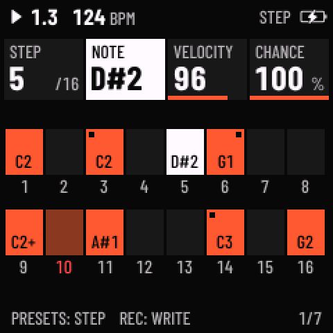<br><sub><b>STEP</b>: sixteen tiles, the notes on them; hold one and turn a knob to lock it</sub></td>
<td width="33%">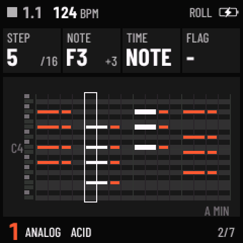<br><sub><b>ROLL</b>: the piano roll, chords and ties, the cursor step framed</sub></td>
<td width="33%">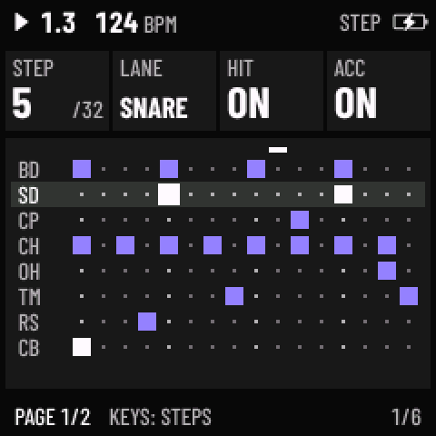<br><sub><b>Drum grid</b>: the kit's eight lanes, accents bright, the white keys the steps</sub></td>
</tr>
<tr>
<td>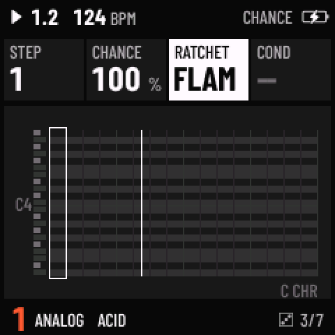<br><sub><b>CHANCE</b>: a step's chance, ratchet or FLAM, trig condition</sub></td>
<td>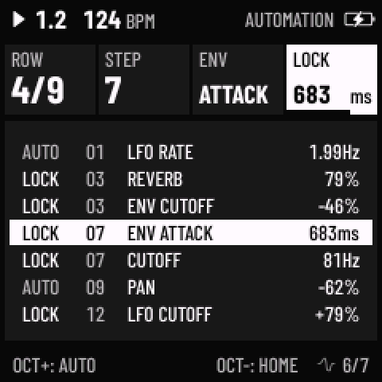<br><sub><b>AUTOMATION</b>: every recorded move and lock, to edit, move or delete</sub></td>
<td>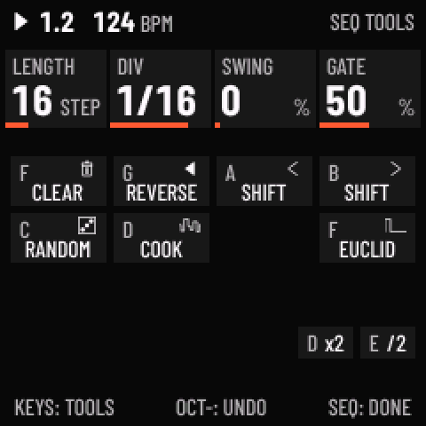<br><sub><b>SEQ TOOLS</b> (hold SEQ): clear, reverse, shift, random, cook</sub></td>
</tr>
</table>

### Patterns, songs and performance

<table>
<tr>
<td width="33%">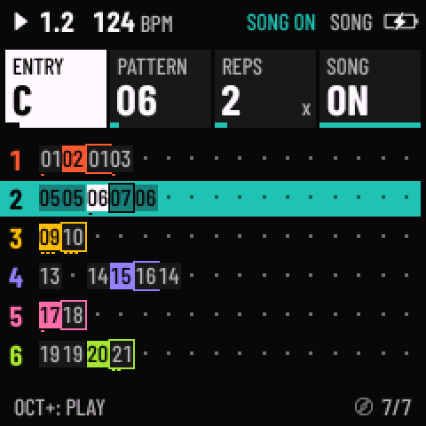<br><sub><b>SONG</b>: each track's list of entries, the one playing filled, the next outlined</sub></td>
<td width="33%">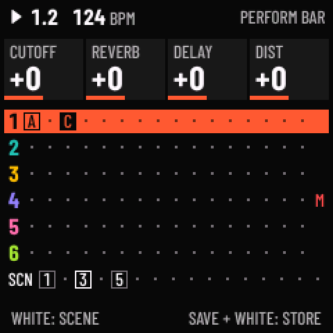<br><sub><b>PERFORM</b> (hold ARP): launch entries, stage mutes, recall scenes</sub></td>
<td width="33%">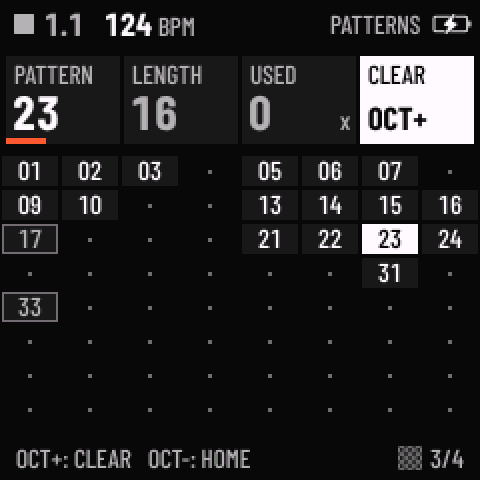<br><sub><b>PATTERNS</b>: the pool of 64, what uses each one</sub></td>
</tr>
<tr>
<td>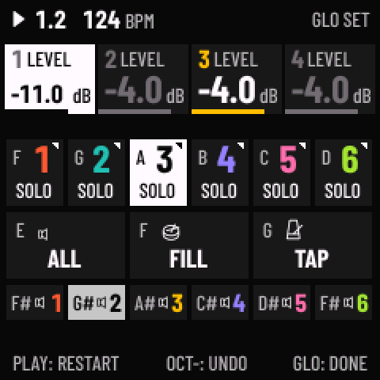<br><sub><b>GLO layer</b>: levels, solos, mutes, FILL, tap tempo</sub></td>
<td>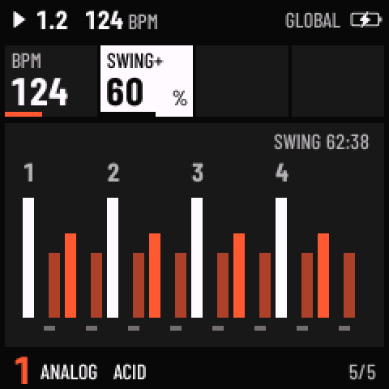<br><sub><b>GLOBAL</b>: tempo and swing, the swung steps drawn</sub></td>
<td>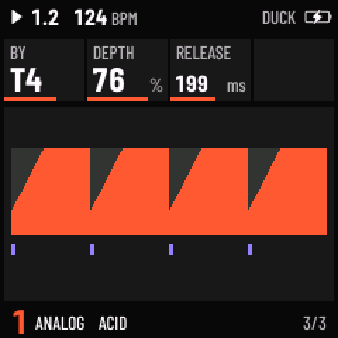<br><sub><b>DUCK</b>: a track dips under another's hits, the pump drawn over a bar</sub></td>
</tr>
</table>

### FM6 from scratch

EDIT › OPERATOR and ALL OPS put every value of an FM6 patch on the unit's knobs: PRESETS picks the operator, SELECT
its ratio, envelope, keyboard scaling, the algorithm, the pitch envelope and the LFO. INIT starts from a bare sine, and
SAVE › USER keeps the result as a sound of its own. The graph, after an idea by Floyd Steinberg, is the note as the
engine plays it: every operator's envelope, each carrier coloured along its length from cool (a sine) to hot (where
the modulators make it bite).

<table>
<tr>
<td width="25%">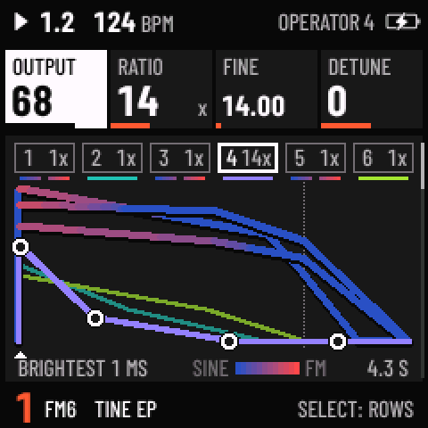<br><sub><b>OPERATOR</b>: OP4's ratio; the carriers hot where it bites</sub></td>
<td width="25%">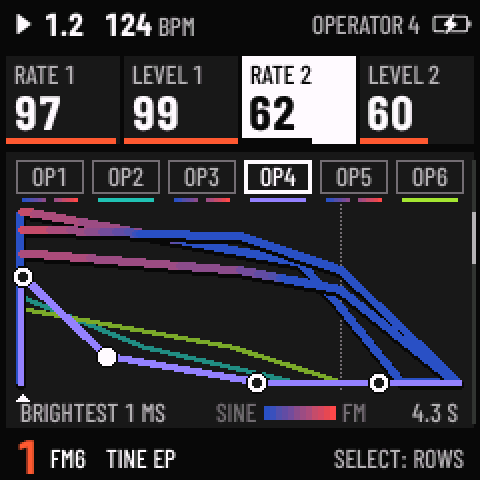<br><sub><b>ENV</b>: the stage being turned, a filled handle</sub></td>
<td width="25%">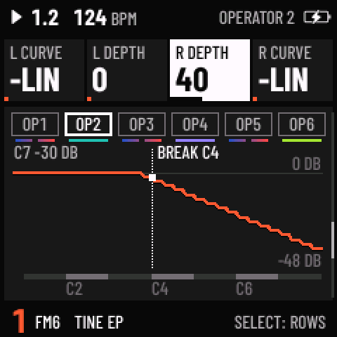<br><sub><b>KEYS</b>: the level across the keyboard</sub></td>
<td width="25%">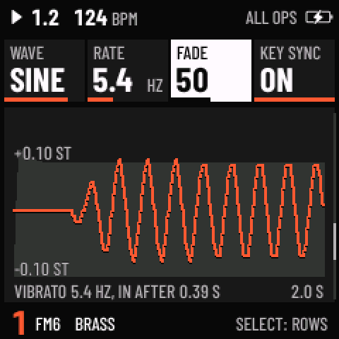<br><sub><b>ALL OPS</b>: the LFO's vibrato fading in</sub></td>
</tr>
</table>

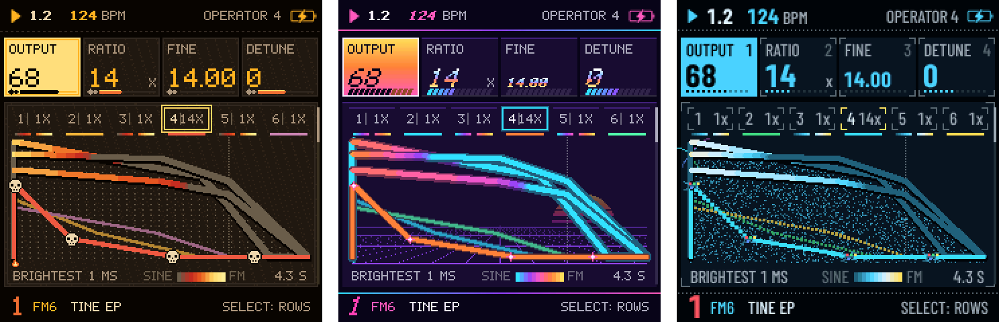

### Sound: every page draws what it does

<table>
<tr>
<td width="25%">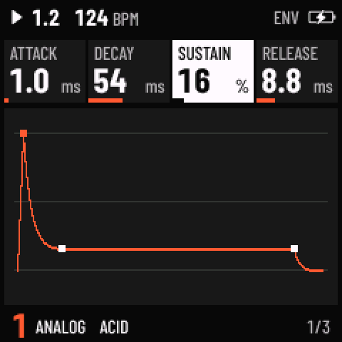<br><sub><b>ENV</b></sub></td>
<td width="25%">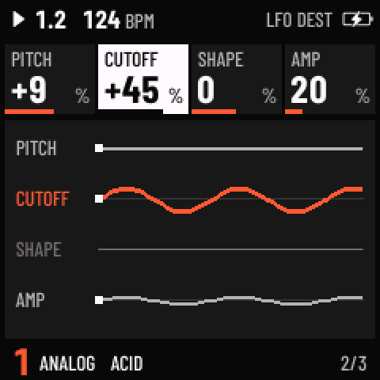<br><sub><b>LFO DEST</b>: the wave per destination</sub></td>
<td width="25%">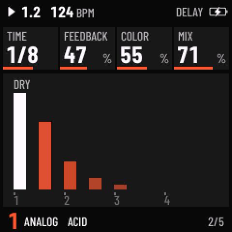<br><sub><b>DELAY</b>: the echoes</sub></td>
<td width="25%">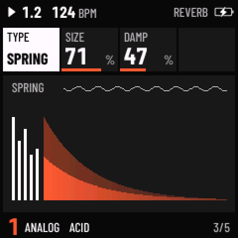<br><sub><b>REVERB</b>: SPRING's tail</sub></td>
</tr>
<tr>
<td>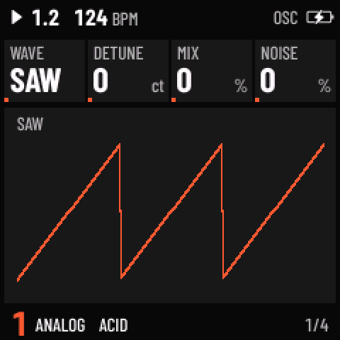<br><sub><b>ANALOG</b>: the oscillator</sub></td>
<td>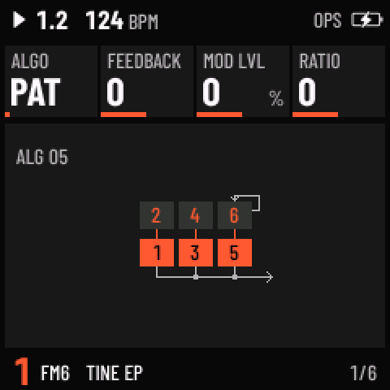<br><sub><b>FM6</b>: its algorithm</sub></td>
<td>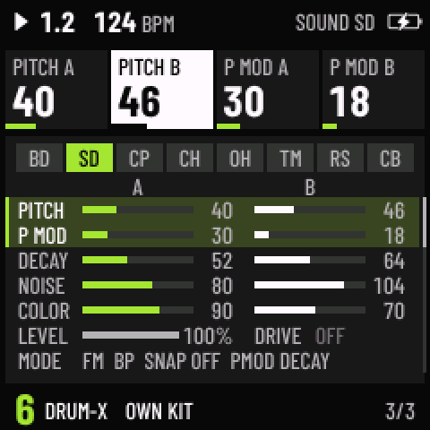<br><sub><b>DRUM-X</b>: a kit sound, A beside B</sub></td>
<td>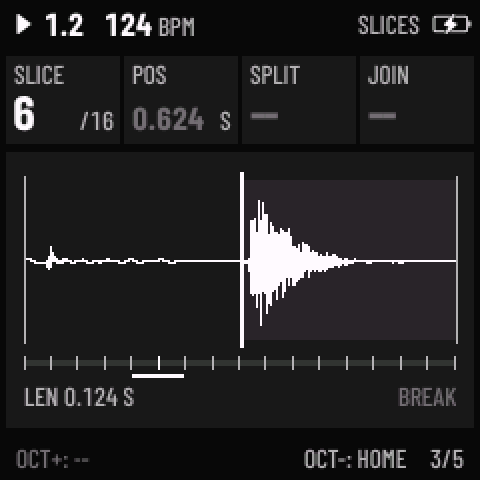<br><sub><b>SLICE</b>: the slices on the wave</sub></td>
</tr>
<tr>
<td>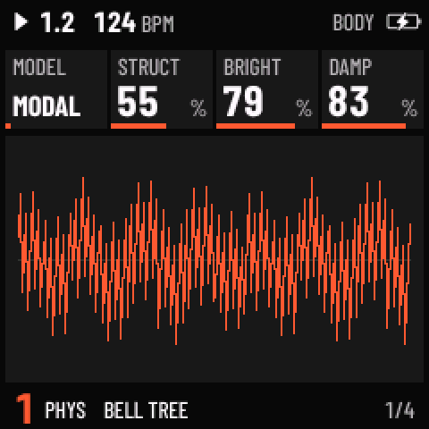<br><sub><b>PHYS</b>: the model sounding</sub></td>
<td>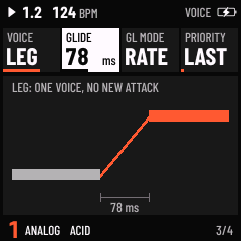<br><sub><b>VOICE</b>: legato and glide</sub></td>
<td>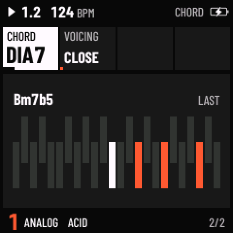<br><sub><b>CHORD</b>: the chord on the keys</sub></td>
<td>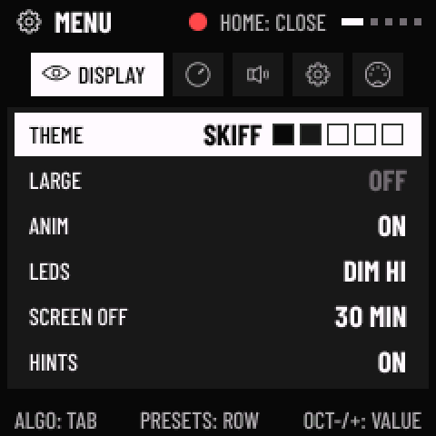<br><sub><b>MENU</b>: four tabs of settings</sub></td>
</tr>
</table>

### Themes

MENU › THEME: **SKIFF** (each track its own colour), **HI-CON**, **PAPER**, **CRYPT** (stone, amber and pixel letters,
the graphs as ASCII art, torches and skulls), **NEON** (synthwave: chrome numbers, neon, the striped sun and the grid,
a car on HOME's highway) and **QUARK** (particle physics: beams and collisions, nuclei, calorimeter towers):

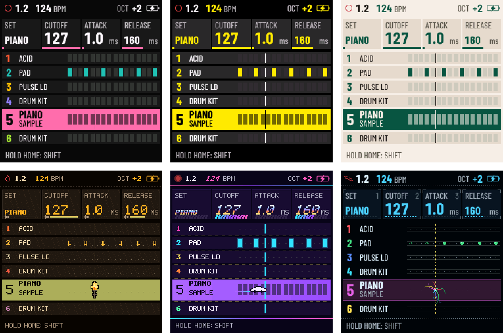

### The web editor

The [Skiff Editor](https://illuminus5.github.io/skiff/webapp/editor/) (`web/editor.html`, Chrome or Edge over USB MIDI)
edits a connected FM-1 live: the sounds and their presets, the steps, the mixer, the Song tab (each track's list, the
scenes, the pattern pool), the projects and their names, the DRUM-X kit and the MENU settings, with PLAY, STOP and REC
at the top. It looks like the unit and follows its THEME. It also keeps a library of sounds on the computer, imports
FM6 patches from `.syx` files and saves complete backups.

<table>
<tr>
<td width="50%">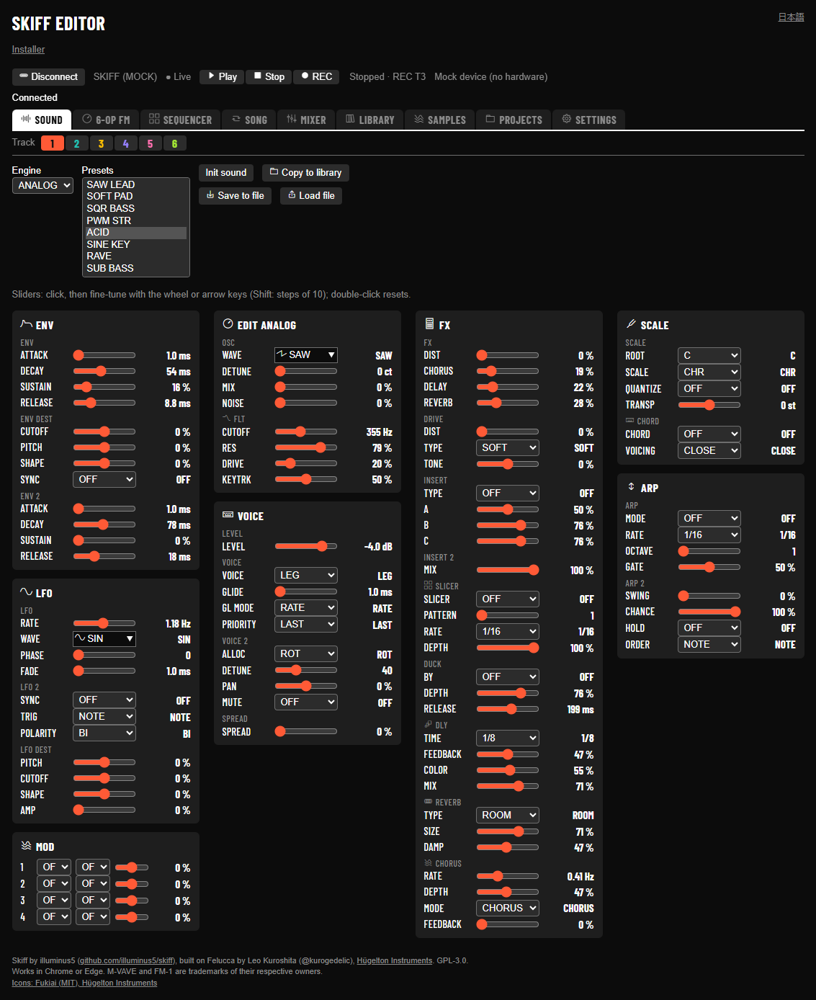<br><sub>The Sound tab: every parameter of the selected track</sub></td>
<td width="50%">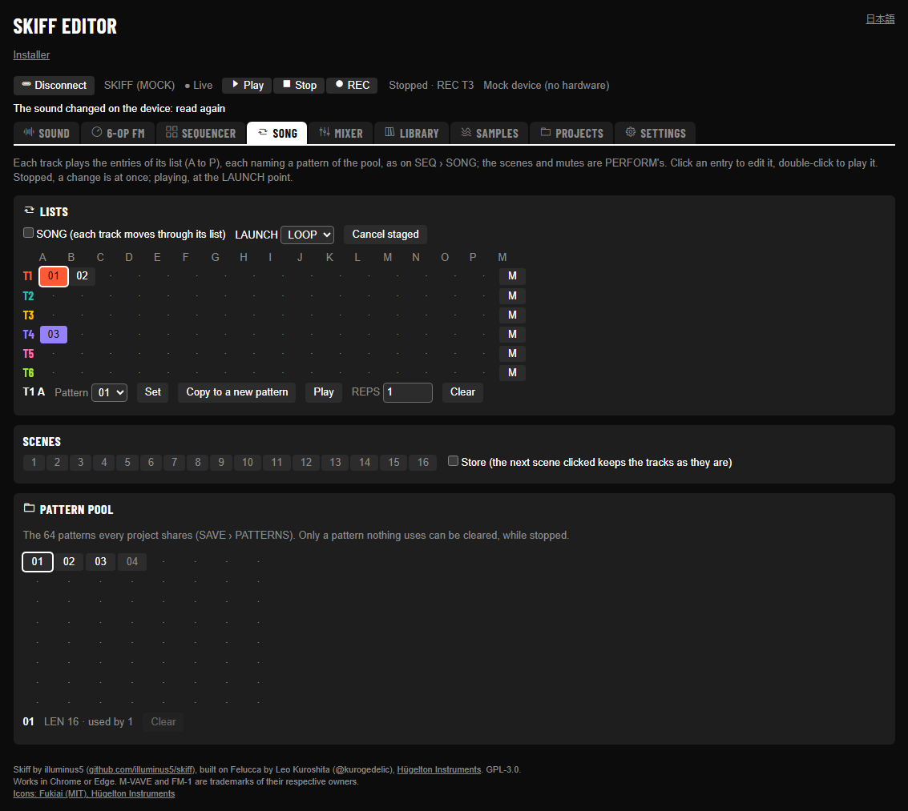<br><sub>The Song tab: the lists, the scenes, the pattern pool</sub></td>
</tr>
<tr>
<td colspan="2">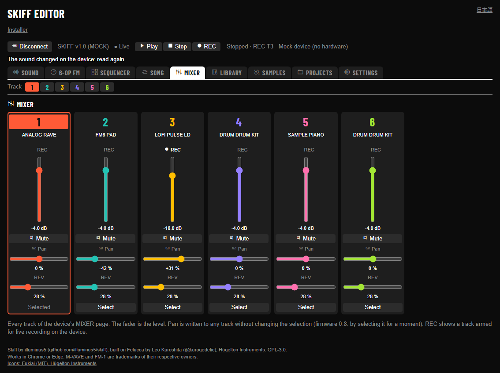<br><sub>The Mixer tab: the six strips</sub></td>
</tr>
</table>

## Features

- **Six tracks**, each its own engine and sound; 8 voices shared between them. T5 and T6 play every engine but
  PHYS and GRAIN. ALGORITHM selects the track on every page; HOME, PERFORM, SONG and the MIXER show all six
- **Fourteen engines** (below), DRUM-X among them, each with its own factory presets
- **FM6 from scratch** (1.1): every value of an FM6 patch on the unit (EDIT › OPERATOR and ALL OPS), INIT a bare
  sine, the sound saved as a user sound; the operators' envelopes drawn as they play, each carrier shaded by its
  brightness, in every theme's own look
- **Every page shows what it does:** the four knobs as cards across the top, and a graph of the page below:
  the envelope, the LFO per destination, the delay's echoes, the reverb's tail, the swing grid, the glide,
  the oscillator and filter, the arpeggio. Hold **HOME** (SHIFT) and a map shows what every button, encoder
  and key does on that page
- **Sequencer:** 64 steps a track with chords, ties, accent, slide, velocity, per-step chance and trig
  conditions (1:2, 3:4 ..), ratchets and **FLAM**, **NUDGE** (a step early or late, in 64ths), a step's own
  GATE, play direction (FWD, RVRS, PING, RAND); SEQ › STEP as 16 tiles, the piano roll (ROLL), a drum grid
  (white keys steps, black keys lanes); live loop recording with overdub, **FEEL** (recording keeps where you
  played), step recording, count-in and click
- **Patterns and songs:** 64 patterns shared by every project; each track has a list of 16 entries (A–P),
  each a pattern played REPS times; **SONG** plays each track down its list. Patterns keep themselves: no save
  needed
- **PERFORM** (hold ARP): launch any track's entries from the white keys, stage mutes on the black ones, on
  the next LOOP, BAR, BEAT or NOW; 16 **scenes** (every track's entry and mute), SAVE held + a key stores one; throws on
  KNOB 1–4 (CUTOFF, REVERB, DELAY, DIST) that glide back over a bar
- **TAKE** (SHIFT + SAVE): keep the last loop you played, notes and knob moves, on the track, after the fact
- **Undo:** SAVE held, 8 levels across the tracks (sound loads, takes, clears, tools, recording passes,
  automation edits); OCT− and OCT+ step through them while the undo box shows
- **Parameter locks and automation:** hold a step and turn a knob to lock it; knob moves recorded live; SEQ ›
  AUTOMATION lists them all to edit, move or delete
- **SEQ TOOLS** (hold SEQ): CLEAR, REVERSE, SHIFT < / >, RANDOM, COOK; on a drum track BEAT and each lane's
  tools
- **DUCK** (FX › DUCK): a track dips under another track's hits, the sidechain pump
- **Effects:** DIST and the SLICER per track; chorus, delay and reverb (ROOM or SPRING) buses on GLO; the FX
  layer (hold FX): repeat, reverse, filter sweeps, tape stop, freeze, harmonizer, and cuts on the black keys
- **Quick layers:** hold FX, GLO, SCL, EDIT, ARP or SEQ for its map on the keys and knobs; SHIFT + the button
  keeps it open. The GLO layer: solos, mutes, FILL, tap tempo
- **DRUM-X** (from [JIANT FM](https://github.com/juanjiant-bit/JIANT)): a synthesized kit of 8 sounds, each
  with an A and a B patch and MORPH between them, one kit per project, edited a sound at a time on EDIT › SOUND
- **Chord keys, arpeggiator, scales:** in-key chords with voicings; an arpeggiator with 14 modes, CHANCE,
  SWING and HOLD; 16 scales with a white-key mode; MONO, LEGATO, UNISON and glide
- **Modulation matrix:** 4 slots a track, MIDI controllers as sources
- **Presets and projects:** factory presets, 32 user sounds and 4 projects, named on the device; the music
  comes back at power-on (RESTORE LAST, an autosave of its own)
- **Screen and LEDs:** the BLOCKS look in Barlow Condensed with Fukiai icons; six themes; MENU › LARGE for tall
  cards; messages say the way out; idle buttons glow, what can be pressed breathes, never blinks
- **USB and MIDI:** class-compliant MIDI in and out, TRS MIDI in, a stereo USB audio input to record the
  master on a computer; channels 1–6 play tracks 1–6 (MENU › MIDI IN CH1-6); clock from internal, USB or TRS

### Patterns, lists and the song

The notes live in **patterns**, and a project says which ones each track plays:

- **A pattern** is a track's notes exactly as they play: all 64 steps whole, LENGTH, DIV, SWING, GATE and DIR, and
  the track's automation and locks. The sound is not part of it. There are 64 of them, **01–64**, in one **pool**
  that every project shares (SAVE › PATTERNS); entries naming the same pattern share it, and COPY gives an entry its
  own.
- **Each track has a list** of 16 entries, A–P. An entry names a pattern (or none) and its REPS, the passes it plays
  (1–16). A track is always on one entry, and HOME, the SEQ pages and the keys edit that entry's pattern.
- **Nothing to save:** what a track has is kept as the pattern it is on, written to flash at the quiet autosave (and
  before a project save or load, or a backup).
- **Playing an entry** (SEQ › SONG's OCT+, a PERFORM key, a scene, or a double-click in the editor) switches at once
  when stopped, and when playing at the **LAUNCH** point: the track's pass end (LOOP), the next BAR, BEAT, or NOW.
- **SONG ON:** while playing, each track moves to its next entry once the current one's REPS are played, at its own
  pass end; empty entries are skipped, and after the last comes the first. Tracks of different lengths move on at
  different times. **SONG OFF:** each track loops its entry. GLO + PLAY starts every track from its first entry.
- **Scenes** (16, in the project) keep the entry each track is on and every mute; SAVE held + a key stores one, a key
  recalls it, staged so that it all lands together.

## Controls

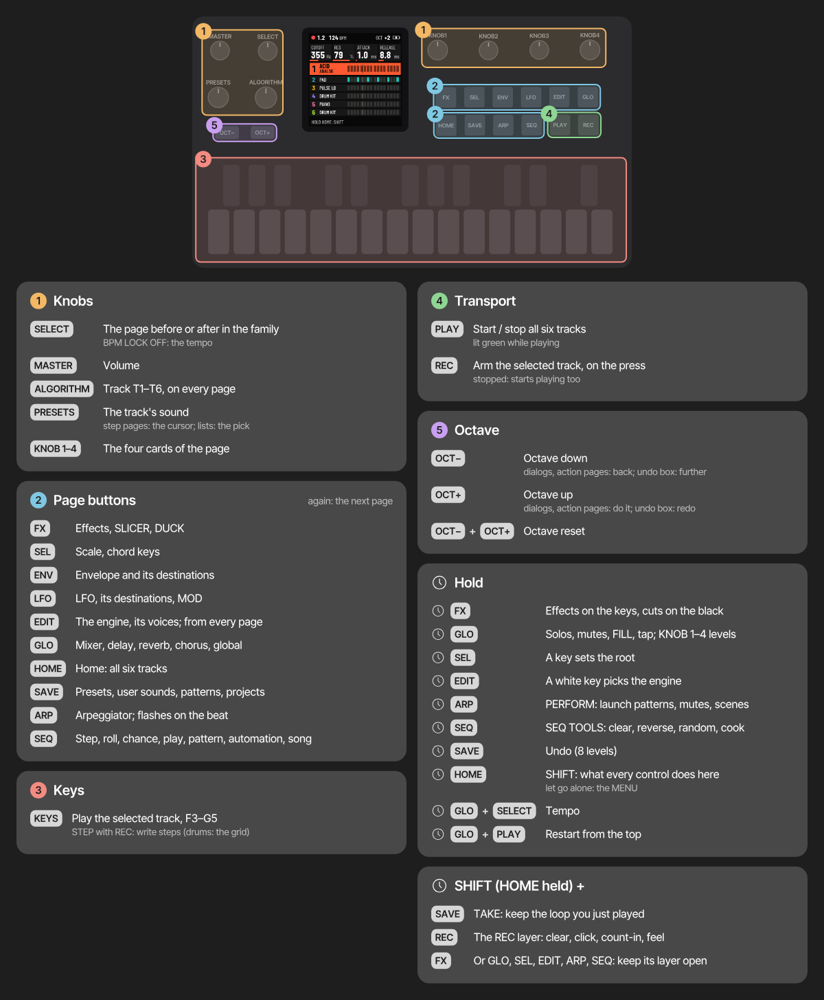

The black keys' legends are M-VAVE's: [docs/keystrip.pdf](docs/keystrip.pdf) is a strip to print (at 100 %) and lay
by the keys, with what each key is in Skiff.

- Tap a page button for its pages (again, or SELECT, for the next one); every family reopens the page you left
- **HOME** goes home. **Held**, it is SHIFT: its map shows what every control does on the page; let go alone,
  the MENU opens
- Hold FX, GLO, SCL, EDIT, ARP or SEQ for its layer; **SHIFT + the button** keeps it open (the header says
  LOCKED), the button closes it. A locked FX layer latches its effects
- **SAVE** tapped: its pages (PRESETS, USER, PATTERNS, PROJECT); **held**: undo. **SHIFT + SAVE**: TAKE
- **REC** arms or disarms the selected track the moment it is pressed. **SHIFT + REC** opens the REC layer:
  F3 held clears the track's sequence, then CLICK, COUNT-IN, CLICK LEVEL, FEEL
- **EDIT** opens the EDIT pages everywhere; on STEP and ROLL with REC armed it clears the cursor step
- **SELECT** turns the pages of a family; **GLO + SELECT** sets the tempo (MENU › BPM LOCK, on by default)
- **PRESETS** changes the sound; on the step pages it moves the cursor, on lists it picks
- On action pages and in dialogs, **OCT+** does it and **OCT−** goes back
- Hold a step on SEQ › STEP and turn KNOB 1–4 to lock those parameters on that step
- Save a sound: stop, tap SAVE (USER), pick a slot with KNOB 1, OCT+, name it with the keys, OCT+

## Engines

In the order the device lists them:

- **ANALOG**: virtual analog; two oscillators, noise, drive, resonant low-pass filter
- **FM6**: classic 6-operator FM (Dexed-based): 32 algorithms, a full patch per track, every value of it
  editable on the device (EDIT › OPERATOR and ALL OPS: the operators' envelopes drawn as they play, each
  carrier shaded by how bright the modulators make it) or in the web editor (which imports .syx files);
  INIT starts from a bare sine; macros on the device, an algorithm chart; SLOT picks a factory patch
  (F1–F8) or the track's own (OWN)
- **PHASE**: phase distortion (ported from CrispyZebra)
- **LOFI**: chiptune; pulse, triangle, saw, noise and a 4-bit wave RAM, stepped envelope, sweep, arpeggio
- **SAMPLE**: multisampled instruments and 3 user sample slots
- **VOICE**: formant oscillator, sung vowels
- **TRIO**: 3 oscillators with ring modulation and sync, multimode filter
- **WHEEL**: tonewheel-style organ; drawbar registrations, percussion, key click, drive, rotary speaker
- **GRAIN**: granular textures from the built-in samples or a user slot
- **PHYS**: physical models: modal resonators, strings, struck membranes, sympathetic strings
- **NOISE**: noise from analog to digital: colours, crackle, shift-register and metallic tones
- **SLICE**: a drum break, a piano note (both built in) or your own sample cut into slices, one per key;
  set the slices by hand on the SLICES page
- **DRUM**: an 8-lane kit of Felucca's own drum voices on the General MIDI key map. KIT picks the
  standard kit or one of five virtual-analog (VA) kits in the manner of
  classic analog drum machines (the numbers are a hint), every lane its own voice: **80** (deep sine kick with a long decay, noisy snare,
  six-square hats), **10** (swept kick, white-noise snare, long-tailed claps, a cymbal), **66** (soft
  round kick, bright snare, noise hats, a conga), **55** (dropping kick, high metal hats, a metal bell)
  and **77** (swelling kick, multi-burst claps, claves, a cymbal). All of them are synthesized, no samples.
  EDIT › LANES sets each lane's level (KNOB 1 the lane, KNOB 2 its level)
- **DRUM-X**: a synthesized 8-sound kit from [JIANT FM](https://github.com/juanjiant-bit/JIANT), after the idea of
  Sonic Charge's Microtonic: each sound an oscillator (SIN, FM, MTL, BEL) with a pitch envelope and filtered noise,
  two patches A and B with MORPH between them; one kit a project, edited on EDIT › SOUND, a sound at a time

**SLICER** (FX › SLICER, every track): a tempo-synced 16-step gate or stutter, with 16 patterns.

<details>
<summary><b>Notes for Felucca users</b></summary>

The DIGITAL engine of Felucca 0.9 became FM6: projects and presets with DIGITAL sounds load as FM6 sounds converted
from them. The SAMPLE engine's PERC kit was removed in Felucca 1.0.2: sounds and projects that used it load as the
DRUM engine's kit, on the same key map. FM6's patch bank (the B slots) was removed in 1.0.3: user presets keep their
own FM6 patch. SLICE gained a second built-in sound in 1.0.4, PIANO, next to BREAK. A missing sample (an empty user
slot) plays a plain sine at the note's pitch on SAMPLE, GRAIN and SLICE, and the screen says NO SAMPLE once. DRUM's
KIT variants HAND, CYM and H+CYM were retired in 1.0.5: sounds and projects that used them play the 66, 10 and 77
kits. Felucca's projects become Skiff's at the first start: each track's steps a pattern on its entry A.
</details>

## Menu

Hold **HOME** and let it go for the menu. It is in four tabs: **DISPLAY** (THEME to LEDS, SCREEN OFF, HINTS),
**CONTROL** (HOLD to BPM LOCK, SCALE LEDS, CLOCK, MIDI IN), **AUDIO** (SPEAKER EQ, USB LEVEL, CLICK, CLICK LEVEL,
COUNT-IN, TUNE) and **SYSTEM** (USB SERIAL, RESTORE LAST, CPU, HARDWARE CALIBRATION, RESET SETTINGS, ABOUT).
ALGORITHM moves between the tabs and PRESETS through the rows of one; any of KNOB 1–4, or OCT+ / OCT−,
changes the value (OCT+ opens HARDWARE CALIBRATION and ABOUT); press HOME to close the menu. RESET SETTINGS puts
every setting back as a new unit has it. The web editor's Settings tab reads and changes them too.

<details>
<summary><b>Every setting</b></summary>

- **THEME:** SKIFF (each track its own colour), HI-CON (high contrast), PAPER (light), CRYPT (a dungeon synth's:
  stone, amber, pixel letters, the graphs as ASCII art, torches and skulls), NEON (synthwave: chrome numbers, neon,
  the striped sun and the grid, a car on HOME's highway) or QUARK (particle physics: beams and collisions, nuclei,
  calorimeter towers, the tracks the colour charges); the web editor follows it. A unit on a palette of before that
  is gone (GREY, GREEN, AMBER, ICE, VIOLET, ROSE, NIGHT, MONO) starts on SKIFF
- **LARGE:** OFF or ON: on HOME and the value pages the four knob cards grow tall, marked K1–K4, with
  larger labels and values about twice the size; the graph below becomes a strip. Lists, the piano roll,
  the drum grid and the quick layers keep their layout with larger labels
- **ANIM:** ON or OFF; OFF shows every change at once, without rolling digits, a gliding piano roll or
  the LED sweep at power-on
- **LEDS:** OFF (no glow), DIM LO, DIM HI (default) or INV (the idle LEDs lit, the active ones dark).
  What can be pressed breathes up to about 60 % of a lit LED, about 30 % with DIM LO
- **SCREEN OFF:** NEVER, 5 MIN, 15 MIN, 30 MIN (default) or 60 MIN: after that long with no button, key or
  knob touched, the screen and its backlight go off; the sound, the sequencer, MIDI and USB go on. The next
  button, key or knob only turns the screen back on (PLAY still stops the music). Never while the music
  plays
- **HOLD:** how long a button is held before its hold acts (the layers, SAVE's undo, HOME's SHIFT)
- **KNOB ACCEL:** OFF (one step per click) or ON: a fast, steady turn of a wide value moves 2 to 4 steps
  per click, up to 8 on values of more than 64 steps, the FX and GLO layers' knobs included; lists never
  jump. ON or OFF, every click of a fast turn counts
- **BPM LOCK:** ON (default), SELECT turns the pages of a family; hold GLO and turn SELECT, tap F4 in the GLO
  layer or use GLO › GLOBAL for the tempo. OFF, SELECT is the tempo everywhere, Felucca's way. Skiff turns it
  ON once on a unit coming from Felucca; DRUM-X's SOUND sheet and FM6's OPERATOR and ALL OPS move their rows with
  SELECT either way
- **SCALE LEDS:** OFF or ON: the keys show the selected track's scale all the time (the root a little
  brighter); not on DRUM or SLICE tracks
- **CLOCK:** INT, USB or TRS, where the tempo comes from. **MIDI IN:** CH1-6, channels 1–6 play tracks 1–6,
  or SEL, every channel the selected track. **TUNE** (AUDIO): the whole unit in cents, ±50. The three are the
  unit's, so loading a project never changes them
- **CPU** (SYSTEM): how busy the audio is, read only
- **HINTS** (DISPLAY): ON or OFF; OFF drops the one line of hint (HOLD HOME: SHIFT, KEYS: STEPS, a layer's
  first HOLD [X]: SHORTCUTS) and SHIFT's map; what OCT+ and OCT- do on an action page stays
- **RESET SETTINGS** (SYSTEM): OCT+ asks, then puts every MENU setting back as a new unit has it; the
  calibration, the favourite sounds and the music stay
- **SPEAKER EQ:** FLAT, LOWCUT or BASS+, a tone setting for the built-in speaker (not a switch). It also
  shapes the headphone out and USB audio, so keep it on FLAT when recording. The firmware cannot turn
  the speaker off, but headphones in the jack do
- **USB LEVEL:** MASTER (the MASTER knob sets the USB audio level too) or FIXED (USB always at full
  level, MASTER sets only the speaker and headphones)
- **CLICK:** OFF (default), REC (while a track is armed) or ON: a click on every beat while playing, the
  bar's first beat higher. **CLICK LEVEL:** LOW, MID (default) or HIGH; MASTER sets it too
- **COUNT-IN:** OFF (default), 1 BAR or 2 BARS: with a track armed, PLAY counts in first (clicking even with
  CLICK OFF), and a note played in the last half beat lands on step 1. Not with an external clock
- **USB SERIAL:** ON or OFF, applied when the menu closes (the FM-1 reconnects). OFF leaves out the
  serial console, a developer tool, so the FM-1 is a plain audio + MIDI device; this lets macOS 13–15
  see its USB audio input. MIDI, the editor and the installer work either way
- **RESTORE LAST:** ON (default) or OFF. ON, the FM-1 starts with the music you left (the header says
  RESTORED), kept in an autosave apart from the four projects; it is written when the music changed, the
  transport is stopped and nothing has been touched for 10 s, at most once a minute. OFF starts with the
  power-on sounds
- **HARDWARE CALIBRATION** and **ABOUT** (the version, the credits and a QR code to this repository)
</details>

## Scale keyboard

On the **SCL** page, set **QNT** to WHITE to play the selected scale using only the white keys (SNAP keeps every key
and rounds it down to the scale). C4 plays **ROOT**; consecutive white keys play consecutive scale notes above and
below it. Black keys are silent, including during live recording and step entry. **TRN** transposes the resulting
notes; the octave buttons shift them by full octaves. Set QNT to OFF for the normal chromatic keyboard. QNT SEQ snaps
the keys like SNAP and also maps the sequenced notes onto the current ROOT / SCALE as they play (the steps are not
changed; drum kits are never quantized).

Scales: chromatic (CHR), major (MAJ), natural minor (MIN), Dorian (DOR), Mixolydian (MIX), major pentatonic (PEN),
minor pentatonic (MPEN), harmonic minor (HARM), Phrygian (PHRY), Lydian (LYD), Locrian (LOC), ascending melodic minor
(MEL), minor blues (BLUES), whole tone (WHOLE), half-whole diminished (DIMHW) and whole-half diminished (DIMWH). Scales
with other than seven notes continue across the white keys without repeating notes. Drum kits and incoming MIDI keep
their own note mapping. Press **SCL** again for the **CHORD** page: CHRD picks the chord keys (OFF, the scale's triads
or sevenths, or a fixed shape) and VOIC the voicing.

## Build from source

[BUILDING.md](BUILDING.md): the toolchain, the JieLi AC79 SDK the package needs three files from, `./build.sh`
(writes `build/felucca.fwsc`) and `tests/run_tests.sh`, the host tests every change keeps passing. How every screen
and control behaves, rule by rule: [DESIGN.md](DESIGN.md). The editor's protocol:
[web/EDITOR_PROTOCOL.md](web/EDITOR_PROTOCOL.md). Contributions: [CONTRIBUTING.md](CONTRIBUTING.md).

| Path | What |
| --- | --- |
| `firmware/` | firmware sources: `src/` app, `hal/` hardware layer, `loader/` update loader |
| `tools/` | build script, generators, package maker, installer and sample uploader |
| `assets/` | UI fonts, icon names, CC0 instrument samples |
| `web/` | the web installer, the editor (`editor.html`, its protocol `EDITOR_PROTOCOL.md`) and the browser emulator (`web/emu/`) |
| `design/` | the mockups the looks were chosen from, the logo's generator |
| `tests/` | tests that run on the build machine |
| `docs/` | the README's pictures, the logo, the controls card and key strip |
| `LICENSES/` | licence texts of the bundled fonts, icons, ported DSP and SDK files |

## If the FM-1 does not start

If an update is interrupted and the FM-1 stays black, check whether a computer sees it as a USB device named
**WL80UBOOT** (or a USB mass-storage device with ID 4C4A:8057). That is the chip's built-in boot mode, and
the FM-1 can be brought back:

- First try another USB data cable, and close every other app that uses MIDI, then run `tools/fm1_install.py`
  again: it finishes an interrupted update.
- If it stays in boot mode, [FM-1 Transporter](https://github.com/kurogedelic/FM-1-transporter) reads and
  writes the FM-1's flash from a Mac through a Seeed XIAO RP2040 (three wires to the FM-1's USB lines). Back up
  the flash first, then write the official firmware (M-VAVE's FM-1.fwsc).

## Support

Skiff stands on Felucca. If it is useful to you, support Felucca's author:
[sponsoring on GitHub](https://github.com/sponsors/hugelton) or a donation on
[itch.io](https://hugelton.itch.io/felucca).

## Credits

- **[Felucca](https://github.com/hugelton/Felucca)** by **[Hügelton Instruments](https://hugelton.com)** (Leo
  Kuroshita, [@kurogedelic](https://github.com/kurogedelic)): the firmware Skiff is built on; the PHASE engine's waveforms (a C port of the oscillator of
  [CrispyZebra](https://github.com/hugelton/CrispyZebra), GPL-3.0); the DRUM voices and kits; the Hügelton Sample
  Pack (the drum samples, GPL-3.0-only, not CC0); the [Fukiai](https://github.com/hugelton/Fukiai) icon
  font ([MIT](LICENSES/MIT-Fukiai.txt))
- Fonts: [Barlow Condensed](https://github.com/jpt/barlow) by The Barlow Project Authors (the screen and the editor),
  [SIL OFL 1.1](LICENSES/OFL-BarlowCondensed.txt); [Inter Tight](https://github.com/rsms/inter-tight) by The Inter Project Authors (the control card), [SIL OFL 1.1](LICENSES/OFL-InterTight.txt);
  the browser emulator's labels: [DotGothic16](https://github.com/fontworks-fonts/DotGothic16) by The DotGothic16 Project Authors, [SIL OFL 1.1](LICENSES/OFL-DotGothic16.txt)
- Samples: [Versilian Studios](https://versilian-studios.com/) [VSCO-2 Community Edition](https://github.com/sgossner/VSCO-2-CE) and [VCSL](https://github.com/sgossner/VCSL), CC0 1.0: the SAMPLE sets, also SLICE's PIANO ([attribution](assets/samples-cc0/ATTRIBUTION.txt))
- VOICE engine: after [klattsch](https://github.com/tgies/klattsch) by Tony Gies (MIT); formant data from Klatt (1980) and Hillenbrand et al. (1995)
- PHYS engine: models ported from [DaisySP](https://github.com/electro-smith/DaisySP) by Electrosmith and Emilie Gillet ([MIT](LICENSES/MIT-DaisySP.txt)) and from Emilie Gillet's [eurorack](https://github.com/pichenettes/eurorack) code ([MIT](LICENSES/MIT-Rings.txt))
- FM6 engine: msfa from [Dexed](https://github.com/asb2m10/dexed) by Google Inc. and Pascal Gauthier ([Apache-2.0](LICENSES/Apache-2.0-msfa.txt))
- DRUM-X engine: from [JIANT FM](https://github.com/juanjiant-bit/JIANT) by [juanjiant-bit](https://github.com/juanjiant-bit) (GPL-3.0-only), after the idea of Sonic Charge's Microtonic
- Browser emulator: after [X0X](https://github.com/charlesvestal/fm1-x0x) by [charlesvestal](https://github.com/charlesvestal) (GPL-3.0), a Felucca fork whose browser build showed the way
- Package format and boot files: [JieLi AC79 SDK](https://gitee.com/Jieli-Tech/fw-AC79_AIoT_SDK) ([Apache-2.0](LICENSES/Apache-2.0.txt); three of its files are in every package, none in this tree)
- Contributions to Felucca: [keremimo](https://github.com/keremimo) (white-key scales, #2), [ChanceTheMaker](https://github.com/ChanceTheMaker)
  (TRS MIDI, bend, sustain and clock, palettes, favourites, editor display settings: #8, #10, #11, #12),
  [andreahaku](https://github.com/andreahaku) (sample recording and trim, #29; SLICE manual slices and tests, #27, #22),
  [spinkham](https://github.com/spinkham) (the boot fix for 0.9 projects, #111),
  [zednaked](https://github.com/zednaked) (ratchets, #100),
  [jasonpersinger](https://github.com/jasonpersinger) (the ROOM reverb click fix, #121)

## Licence

Free software: [GPL-3.0-only](LICENSE), the Hügelton Sample Pack included. Skiff is a modified version of
Felucca; its changes are marked (Skiff) in the sources. The bundled fonts and the ported DSP keep their own
licences ([LICENSES/](LICENSES/)); details in [LICENSING.md](LICENSING.md).

M-VAVE and FM-1 are trademarks of their respective owners. Skiff and Felucca are not affiliated with or endorsed
by them, and Skiff is not made or endorsed by Hügelton Instruments.

Copyright (C) 2026 Leo Kuroshita (@kurogedelic), Hügelton Instruments (Felucca)<br>
Copyright (C) 2026 illuminus5 (Skiff)
