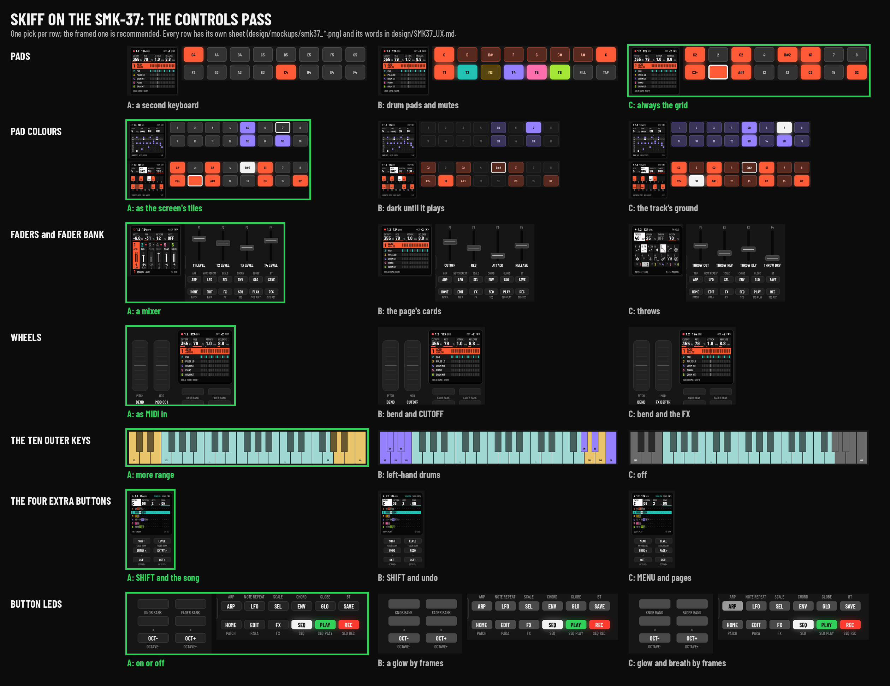
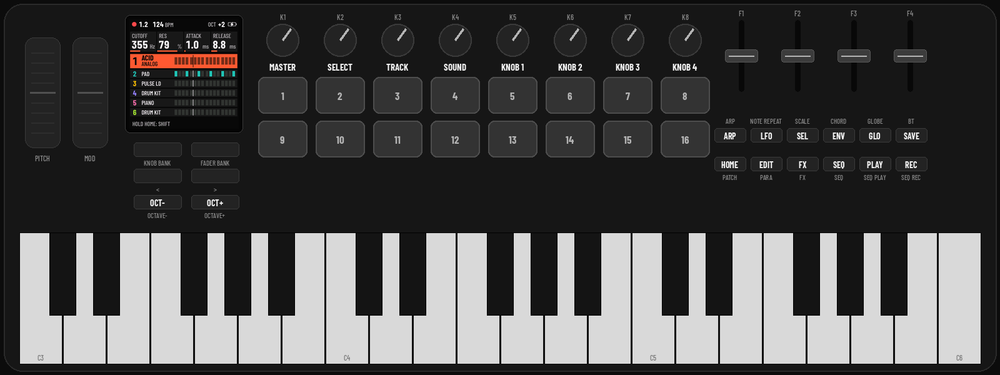
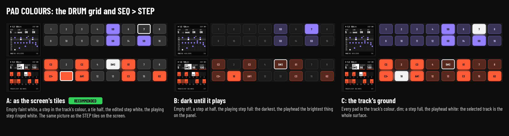
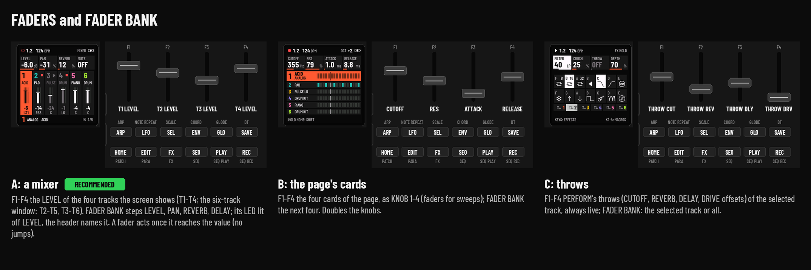
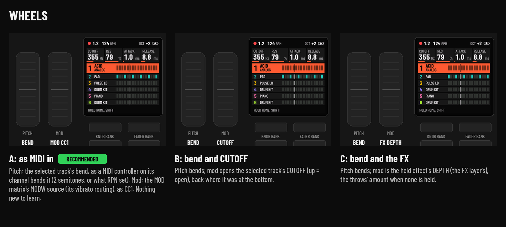
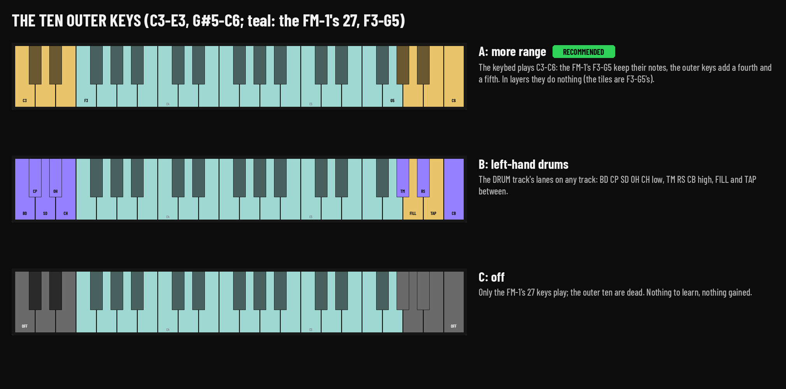
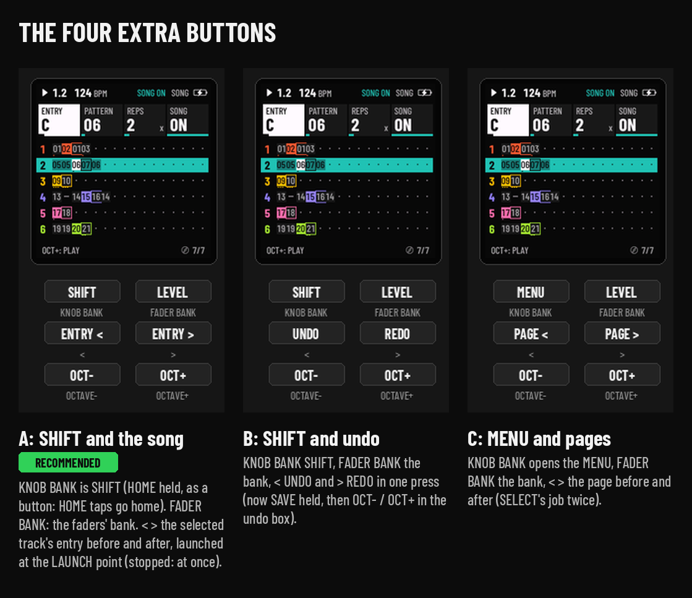
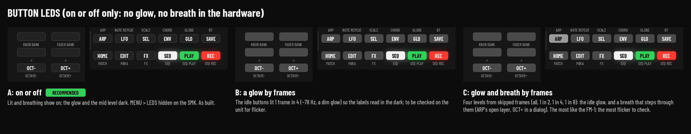

# Skiff on the SMK-37: the controls pass, to pick from

Mockups for the SMK-37 decisions in [SMK37.md](../SMK37.md). There is one row per decision, and each has 2 or 3
directions; the recommended one is marked. The pictures are drawn by `design/mock_smk37.py`, and the screens in them are
the firmware's own renders.

**Picked (2026-10-19): every recommendation.** Pads C, pad colours A, faders A, wheels A, outer keys A, extra buttons
A, button LEDs A, and the recommended answers to questions 8 to 17. Built on branch `smk37-controls`.

**Answering:** one letter per row is enough, for example `pads C, colours A, faders A, wheels A, outer A, buttons A,
LEDs A`. Then answer questions 8 to 16 below (yes / no / your own). A direction can also be changed or mixed ("C, but
the bottom row as B's mutes").

**As built today** (`smk37`, the bring-up default): the FM-1's jobs on the SMK's printed names. PATCH is HOME, PARA is
EDIT, SCALE is SEL, CHORD is ENV, NOTE REPEAT is LFO, GLOBE is GLO and BT is SAVE. K1 is MASTER, K2 SELECT, K3 the
track (ALGORITHM), K4 the sound (PRESETS), and K5..K8 KNOB 1..4.

## 1. Pads: what they do

The 16 RGB pads sit where the FM-1 has no equivalent, and the SMK has no LEDs under its keys. Each direction is shown
in four places:
- a DRUM grid;
- SEQ > STEP on a melodic track;
- PERFORM (ARP held);
- HOME with a chord held.

| | Direction | What the pads do | What the keybed does |
| --- | --- | --- | --- |
| A | A second keyboard ([picture](mockups/smk37_pads_A.png)) | the FM-1's 16 white keys everywhere: a grid on step pages and layers, a keyboard (low row = F3..F4) elsewhere | the FM-1's keys, tiles included |
| B | Drum pads and mutes ([picture](mockups/smk37_pads_B.png)) | top row: a DRUM track's 8 lanes, or a melodic track's scale; bottom row: mutes T1..T6, FILL, TAP, always | every FM-1 key job, unlit (steps, entries, effects: only the screen shows them) |
| C | **Always the grid** ([picture](mockups/smk37_pads_C.png)) | as A on step pages, the grid and every layer; on HOME and the sound pages, the selected track's 16 steps with the playhead (a tap sets or clears a step, with the last note played) | plays notes |

**Recommended: C.** The FM-1 shows its grids and layer choices on the LEDs under its keys, and the pads are the only
place the SMK can show them. In A, the pads on HOME only repeat the keybed, and they can't hold a black key (the D#4 of
the chord in A's picture). In B, the steps and the PERFORM entries go dark. C keeps the FM-1 manual for every grid and
layer, and turns the pads into the sequence the rest of the time.

## 2. Pad colours

| | Direction | Empty | A step | Playing | Edited |
| --- | --- | --- | --- | --- | --- |
| A | **As the screen's tiles** | faint white | the track's colour (a tie: half) | ringed white | white |
| B | Dark until it plays | off | half | full colour | ringed |
| C | The track's ground | the track's colour, dim | full | white | ringed |

**Recommended: A.** The pads then match the screen's STEP tiles: the same picture on the panel and on the screen.
B makes the steps hard to tell apart in daylight. C loses the grid's empty steps against a bright colour such as amber
or lime. A brightness setting can reuse MENU > LEDS (DIM LO / DIM HI as the pads' level).

## 3. Faders and FADER BANK

- **A, a mixer (recommended):** F1..F4 are the LEVELs of the four tracks the screen shows (T1..T4, or the six-track
  window T2..T5 / T3..T6). FADER BANK steps LEVEL, PAN, REVERB, DELAY; its LED is lit when the bank isn't LEVEL, and the
  header names the bank. A fader takes over only once it reaches the current value, so nothing jumps.
- B, the page's cards: the faders double KNOB 1..4, and FADER BANK moves to the next four.
- C, throws: PERFORM's four throws (CUTOFF, REVERB, DELAY, DRIVE offsets), always live.

**Why A:** mixing six tracks with knobs is the FM-1's weak spot, and B breaks "one control, one job". C is worth
keeping in mind as a FADER BANK step later.

## 4. Wheels

- **A, as MIDI in (recommended):** pitch bends the selected track as a MIDI controller on its channel would (2
  semitones, or what RPN set). Mod is the MOD matrix's MODW source, as CC1. Skiff already does all of this for MIDI
  (`midi_control.c`, `mod.c`).
- B: mod opens the selected track's CUTOFF.
- C: mod is the held effect's DEPTH.

## 5. The ten outer keys (C3..E3, G#5..C6)

- **A, more range (recommended):** the keybed plays C3..C6 and the FM-1's F3..G5 keep their notes. In layers the
  outer keys do nothing.
- B, left-hand drums: the DRUM track's lanes, FILL and TAP on the outer keys, whatever track is selected.
- C, off.

**Why A:** a 37-key keybed should play 37 notes. B is the most fun but hides a second drum kit under the hands, and it
works against a DRUM track's own keys.

## 6. The four extra buttons

| | KNOB BANK | FADER BANK | < | > |
| --- | --- | --- | --- | --- |
| **A (recommended)** | SHIFT (HOME held, as its own button) | the faders' bank | the selected track's entry before | the entry after (at the LAUNCH point; stopped: at once) |
| B | SHIFT | the bank | UNDO | REDO |
| C | MENU | the bank | the page before | the page after |

**Why A:** a real SHIFT frees HOME from its hold. The song moves are new on the panel; the FM-1 has them only
through PERFORM. B repeats SAVE held, and C repeats SELECT.

## 7. Button LEDs

The SMK's button LEDs are on or off only, multiplexed in two groups.
- **A, on or off (recommended for now; as built):** lit or breathing shows on, and the glow is dark. MENU > LEDS is
  hidden on the SMK.
- B, a glow by frames: the idle buttons lit 1 frame in 4 (about 78 Hz).
- C, glow and breath by frames: four levels from skipped frames.

B and C need a look on the unit for flicker before they can be recommended. Nothing in Skiff is shown only on an LED
(rule 6), so A loses no information.

## Questions without a picture

8. **Velocity:** keys and pads play with velocity (the unit's own curves), with a KEY VELOCITY row in MENU (DYNAMIC,
   SOFT, HARD, FIXED 64 / 100 / 127). *Recommended: yes, DYNAMIC by default.*
9. **MASTER on K1:** keep its level across power cycles (in the settings), and show it on screen while turned (a
   header message, MASTER -6 dB)? *Recommended: yes to both.*
10. **Knob names:** the SMK's KNOB 1..4 are K5..K8. Should the SHIFT map and the docs say K5..K8 on the SMK? The cards
    stay as they are. *Recommended: yes.*
11. **USR2 and USR3** (flash layout A keeps one sample slot): hide them from SAMPLE, GRAIN, SLICE and the editor on
    the SMK? *Recommended: yes.*
12. **TRS MIDI OUT** on PC7: write the driver (clock, and the selected track's notes out)? *Recommended: yes, clock
    first.*
13. **The pedal jack:** sustain, as CC64 from MIDI? *Recommended: yes.*
14. **The battery meter:** take the SMK's own thresholds (stock 530 / 560 / 602)? *Recommended: yes, checked on the
    unit.*
15. **Power-on combos** on OCTAVE- and OCTAVE+ (HARDWARE CALIBRATION; held 5 s: UPDATE MODE), as on the FM-1?
    *Recommended: yes.*
16. **The screen:** keep Skiff's UI as it is (the same 240 x 240 panel)? *Recommended: yes.*
17. **Flash layout:** A (built: one sample slot, the full 64-pattern pool), or B, C or D from SMK37.md? *Recommended:
    A.*
